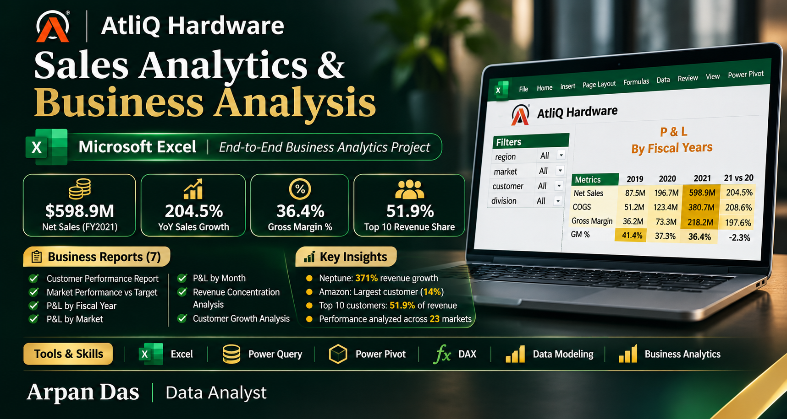
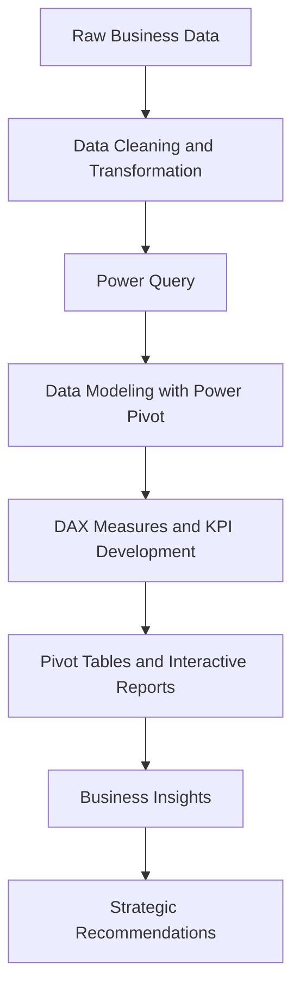

# AtliQ Hardware | Sales & Financial Analytics Using Excel

### Transforming Business Data into Actionable Insights




---

## 📌 Executive Summary

An end-to-end Sales and Financial Analytics project developed using **Microsoft Excel** to evaluate AtliQ Hardware's business performance across customers, international markets and fiscal years.

The project transforms raw business data into structured analytical models, interactive reports and actionable business insights using Power Query, Power Pivot, DAX, Pivot Tables and data visualization.

The analysis focuses on revenue growth, gross profitability, sales target achievement, customer performance and revenue concentration.

| Project Information | Details |
|---|---|
| Company | AtliQ Hardware |
| Industry | Consumer Electronics & Hardware |
| Analysis Period | FY2019–FY2021 |
| Primary Tool | Microsoft Excel |
| Business Domain | Sales & Financial Analytics |
| Project Type | Business Intelligence Portfolio Project |

---

## 📊 Business Performance at a Glance

| Key Performance Indicator | FY2021 |
|:---|---:|
| Net Sales | $598.9M |
| Gross Margin | $218.2M |
| Cost of Goods Sold | $380.7M |
| Gross Margin % | 36.4% |
| Year-over-Year Sales Growth | 204.5% |
| Sales Target Shortfall | $54.9M |
| International Markets Analyzed | 23 |
| Business Reports Developed | 7 |

> Despite significant revenue growth, AtliQ Hardware experienced declining gross margin percentages and a substantial sales target shortfall, highlighting the importance of balancing growth with profitability.

---

## 🏢 Business Problem

AtliQ Hardware operates across multiple international markets and serves a diverse customer base.

Evaluating business performance across multiple datasets requires a consolidated analytical solution that enables stakeholders to monitor sales, assess profitability, identify underperforming markets and evaluate customer growth opportunities.

This project addresses these requirements through a structured Excel-based business reporting solution.

---

## 🎯 Business Objectives

- Evaluate customer-level sales performance.
- Analyze revenue growth across fiscal years.
- Compare actual sales against market-level targets.
- Analyze Profit & Loss across fiscal years, months and markets.
- Monitor gross margin and cost performance.
- Identify high-growth customers.
- Evaluate customer revenue concentration risks.
- Develop actionable business recommendations.

---

## 🛠️ Tools & Technologies

| Tool | Application |
|---|---|
| Microsoft Excel | Business analysis and interactive reporting |
| Power Query | Data cleaning and transformation |
| Power Pivot | Data modeling and table relationships |
| DAX | Business measures and KPI calculations |
| Pivot Tables | Multidimensional data analysis |
| Pivot Charts | Business data visualization |
| Conditional Formatting | Performance comparison and risk identification |

---

## ⚙️ End-to-End Analytical Workflow



### 1. Data Preparation

- Imported relevant business datasets into Excel.
- Cleaned and transformed data using Power Query.
- Standardized data formats.
- Prepared customer, product, market and fiscal date information for analysis.

### 2. Data Modeling

- Integrated relevant fact and dimension tables.
- Established table relationships using Power Pivot.
- Created a structured analytical data model.
- Enabled dynamic filtering across business dimensions.

### 3. KPI Development

- Developed business calculations using DAX.
- Calculated revenue, costs and gross margin.
- Evaluated sales growth and target variance.
- Analyzed customer revenue contribution.

### 4. Business Reporting

- Created interactive Pivot Tables and Pivot Charts.
- Applied conditional formatting to highlight performance.
- Developed structured sales and financial reports.
- Translated analytical findings into business recommendations.

---

## 📐 Key Business Metrics

| Metric | Calculation |
|---|---|
| Net Sales | Sales revenue after applicable deductions |
| COGS | Cost of Goods Sold |
| Gross Margin | Net Sales − COGS |
| Gross Margin % | Gross Margin / Net Sales × 100 |
| YoY Growth % | (Current Year Sales − Previous Year Sales) / Previous Year Sales × 100 |
| Sales Target Variance | Actual Sales − Target Sales |
| Customer Revenue Contribution % | Customer Sales / Total Sales × 100 |

---

## 📈 Business Reports & Analysis

### 01. Customer Sales Performance

Analyzes customer-level net sales across FY2019, FY2020 and FY2021.


**Business Questions Addressed:**

- Which customers contribute the most revenue?
- How has customer performance changed over time?
- Which customers demonstrate strong growth potential?
- Which customer accounts should receive greater strategic attention?

**Selected FY2021 Customer Performance:**

| Customer | Net Sales |
|---|---:|
| Amazon | $82.1M |
| AtliQ Exclusive | $61.1M |
| AtliQ e Store | $53.0M |
| eBay | $15.2M |
| Acclaimed Stores | $10.9M |

**Key Insight:**

Amazon, AtliQ Exclusive and AtliQ e Store collectively generated approximately $196.2M in FY2021 net sales, representing around 32.8% of total revenue.

**Business Value:**

Supports customer segmentation, strategic account management and customer retention planning.

---

### 02. Market Performance vs Sales Target

Evaluates actual sales performance against planned targets across international markets.


| FY2021 Performance | Value |
|---|---:|
| Actual Net Sales | $598.9M |
| Implied Sales Target | $653.8M |
| Sales Target Shortfall | $54.9M |
| Approximate Target Achievement | 91.6% |

**Selected Market Performance:**

| Market | Net Sales | Target Shortfall |
|---|---:|---:|
| India | $161.3M | $9.6M |
| USA | $87.8M | $10.2M |
| South Korea | $49.0M | $4.4M |
| Canada | $35.1M | $5.1M |
| United Kingdom | $34.2M | $3.0M |

**Key Insight:**

Despite strong revenue growth, AtliQ Hardware missed its FY2021 sales target by approximately $54.9M.

The USA and India together accounted for approximately $19.8M of the total target shortfall, making them important markets for further investigation.

**Business Value:**

Supports regional sales planning, target evaluation and identification of underperforming markets.

---

### 03. Profit & Loss by Fiscal Year

Evaluates annual revenue, costs and gross profitability across three fiscal years.


| Financial Metric | FY2019 | FY2020 | FY2021 |
|---|---:|---:|---:|
| Net Sales | $87.5M | $196.7M | $598.9M |
| COGS | $51.2M | $123.4M | $380.7M |
| Gross Margin | $36.2M | $73.3M | $218.2M |
| Gross Margin % | 41.4% | 37.3% | 36.4% |

**Key Insights:**

- Net sales reached approximately 6.8 times their FY2019 level.
- FY2021 recorded approximately 204.5% year-over-year revenue growth.
- Gross margin increased substantially in absolute value.
- Gross margin percentage declined by 5 percentage points between FY2019 and FY2021.
- Cost of goods sold grew faster than net sales between FY2020 and FY2021.

**Business Value:**

Highlights the importance of monitoring cost efficiency and gross profitability alongside revenue growth.

---

### 04. Profit & Loss by Fiscal Month

Analyzes monthly and quarterly financial performance across fiscal years.


**Business Questions Addressed:**

- How does revenue fluctuate throughout the fiscal year?
- Which months generate stronger financial performance?
- How does gross margin change across different periods?
- Are there recurring seasonal performance patterns?

**Business Value:**

Supports financial planning, seasonal demand analysis and monthly performance monitoring.

---

### 05. Profit & Loss by Market

Evaluates market-level revenue, costs and gross profitability.


**Selected FY2021 Market Performance:**

| Market | Net Sales | Gross Margin % |
|---|---:|---:|
| India | $161.26M | 32.0% |
| USA | $87.78M | 37.0% |
| South Korea | $48.97M | 35.9% |
| Canada | $35.06M | 38.2% |
| United Kingdom | $34.15M | 45.1% |
| Japan | $7.92M | 46.5% |
| New Zealand | $11.40M | 48.2% |

**Key Insight:**

India generated the highest net sales, contributing approximately 26.9% of total FY2021 revenue.

However, its gross margin percentage of 32.0% was below the overall business gross margin of 36.4%.

Markets such as New Zealand, Japan and the United Kingdom achieved considerably higher gross margin percentages.

**Business Value:**

Demonstrates the importance of evaluating revenue contribution alongside margin efficiency when assessing market opportunities.

---

### 06. Revenue Concentration Analysis

An additional business analysis developed to evaluate revenue dependency across customers.

**Business Questions Addressed:**

- How dependent is the business on its major customers?
- Which customers account for significant revenue contributions?
- Does customer concentration create potential business risks?

**Key Insight:**

The combined contribution of major customer accounts highlights the importance of monitoring revenue concentration and maintaining a diversified customer portfolio.

**Business Value:**

Supports revenue risk assessment, customer diversification and strategic account management.

---

### 07. Customer Growth Analysis

An additional business analysis focused on evaluating customer sales growth across fiscal periods.

**Business Questions Addressed:**

- Which customers demonstrate strong sales growth?
- Which accounts represent emerging revenue opportunities?
- Which customers should be prioritized for retention and development?

**Business Value:**

Supports customer segmentation, retention planning and strategic account development.

---

## 💡 Key Business Insights

| Business Area | Analytical Finding |
|---|---|
| Revenue Growth | Net sales increased from $87.5M to $598.9M between FY2019 and FY2021. |
| Annual Growth | FY2021 recorded approximately 204.5% YoY sales growth. |
| Gross Margin Pressure | Gross margin declined from 41.4% to 36.4%. |
| Target Achievement | Approximately 91.6% of the implied FY2021 sales target was achieved. |
| Market Performance | India contributed approximately 26.9% of FY2021 net sales. |
| Market Profitability | New Zealand recorded a gross margin of 48.2%, compared with India's 32.0%. |
| Customer Concentration | Amazon, AtliQ Exclusive and AtliQ e Store collectively contributed approximately 32.8% of FY2021 net sales. |

---

## 🚀 Strategic Business Recommendations

| Business Finding | Recommended Action |
|---|---|
| Declining gross margin percentage | Investigate product costs, pricing and discount strategies. |
| $54.9M sales target shortfall | Review regional sales execution and target-setting assumptions. |
| Large target shortfalls in India and USA | Conduct detailed market-level performance reviews. |
| High-revenue, lower-margin markets | Evaluate product mix, pricing and cost optimization opportunities. |
| Higher-margin markets | Assess opportunities for profitable market expansion. |
| Customer revenue concentration | Strengthen customer acquisition and diversification strategies. |
| High-growth customers | Prioritize customer retention and strategic account development. |
| Monthly performance fluctuations | Use historical trends to improve financial planning. |

These recommendations represent potential business actions derived from the analysis and require further investigation before implementation.

---

## 📂 Project Resources

| Resource | Description |
|---|---|
| [Business Reports](./reports/) | Sales, financial and customer analytics reports |
| [Report Screenshots](./screenshots/) | Visual previews of Excel reports |

### Repository Structure

```text
atliq-hardware-excel-business-analysis/
│
├── reports/
│
├── screenshots/
│   ├── excel_project_cover.png.png
│   ├── Screenshot customers net sale performance.png
│   ├── Screenshot market performance vs target.png
│   ├── Screenshot p&l by fiscal year.png
│   ├── Screenshot p&l by market.png
│   └── Screenshot p&l by month.png
│
├── LICENSE
└── README.md
```

---

## 🖥️ How to Explore This Project

1. Navigate to the `reports` folder.
2. Explore the available sales and financial reports.
3. Open the `screenshots` folder to preview the report visuals.
4. Download the available report files for detailed analysis.
5. For interactive Excel workbooks, use Microsoft Excel with Power Pivot support where required.
6. Use the available filters to explore customer, market and fiscal-year performance.

---

## 🧠 Skills Demonstrated

| Technical Skills | Business & Analytical Skills |
|---|---|
| Microsoft Excel | Sales Analytics |
| Power Query | Financial Analysis |
| Power Pivot | Gross Profitability Analysis |
| DAX | Customer Analytics |
| Data Cleaning | Market Performance Analysis |
| Data Transformation | Revenue Growth Analysis |
| Data Modeling | Business Problem Solving |
| Pivot Tables | KPI Development |
| Data Visualization | Analytical Storytelling |
| Interactive Reporting | Business Recommendations |

---

## 🎓 Key Learning Outcomes

Through this project, I strengthened my practical understanding of:

- End-to-end data analytics workflows.
- Data cleaning and transformation using Power Query.
- Building relationships between fact and dimension tables.
- Developing business measures using DAX.
- Creating interactive Excel reports.
- Evaluating financial and sales performance.
- Identifying business risks and growth opportunities.
- Translating business questions into analytical insights.
- Communicating findings through structured business reporting.

---

## 📋 Project Scope & Limitations

- The analysis is based on historical educational portfolio datasets covering FY2019–FY2021.
- Financial values are rounded where applicable.
- Derived percentages are approximate and calculated from reported values.
- Gross margin analysis does not represent complete net profitability.
- The monthly report contains an inconsistent currency label that requires validation against the source data.
- Additional operational and market information would be required to validate the underlying causes of performance differences.
- Recommendations are analytical suggestions rather than implemented business decisions.

---

## 🏁 Conclusion

This project demonstrates how Microsoft Excel can be used as a comprehensive business analytics tool beyond traditional spreadsheet calculations.

By combining Power Query, Power Pivot, DAX, interactive reporting and business analysis, the project provides a structured understanding of AtliQ Hardware's sales and financial performance.

The findings emphasize that sustainable business growth requires a balance between revenue expansion, margin efficiency, sales target achievement and customer diversification.

---

## 🙏 Acknowledgements

Special thanks to **Dhaval Patel Sir** and the entire **Codebasics** team for their excellent guidance, practical learning approach and industry-oriented project resources.

This project was developed as part of my data analytics learning journey, with additional business analysis focused on revenue concentration and customer growth.

---

## 👨‍💻 Author

### Arpan Das

**Data Analyst | SQL | Power BI | Excel | Python**

B.Tech in Mechanical Engineering

Passionate about transforming business data into meaningful insights that support informed decision-making.

[](https://www.linkedin.com/in/arpan-das-785799379)

[](https://github.com/arpan-data)

**Open to entry-level Data Analyst and Business Intelligence opportunities.**

---

*Portfolio Project • Sales Analytics • Financial Analytics • Microsoft Excel*
